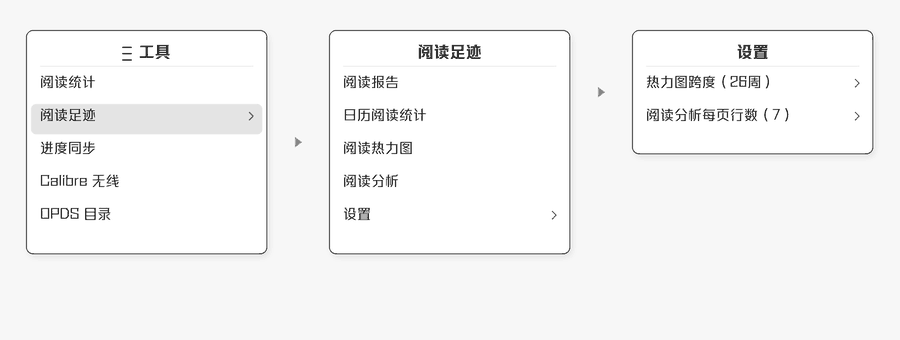
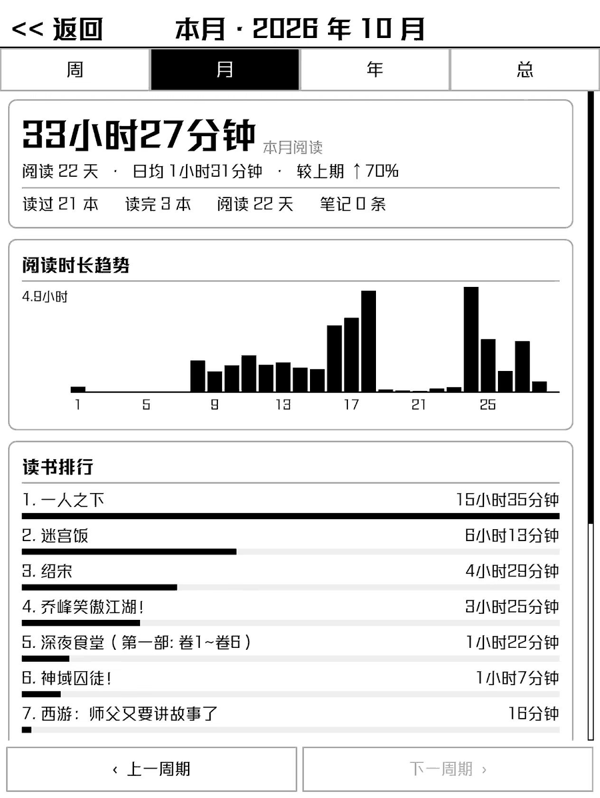
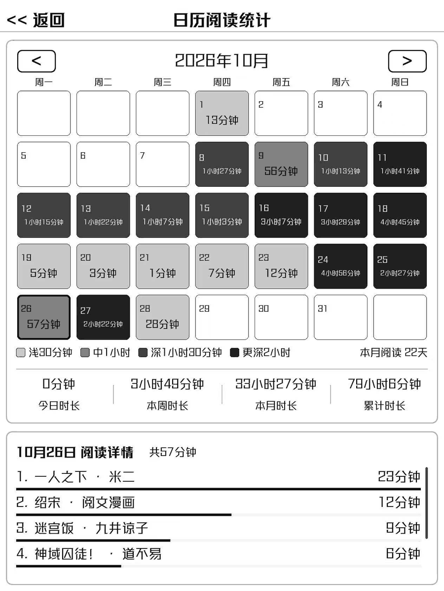
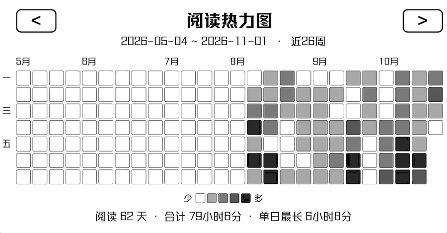
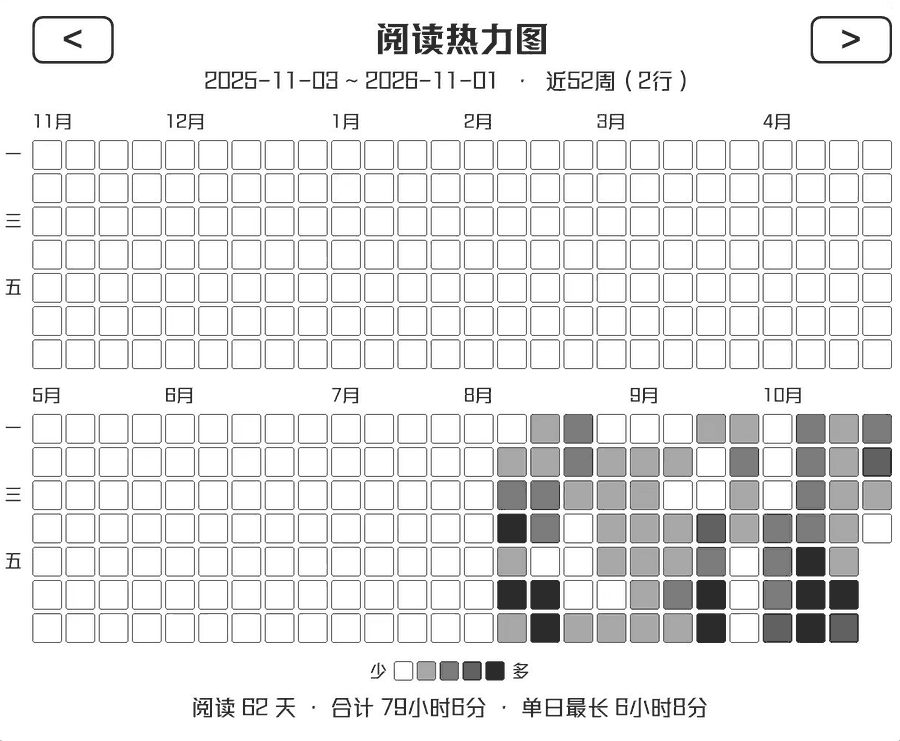
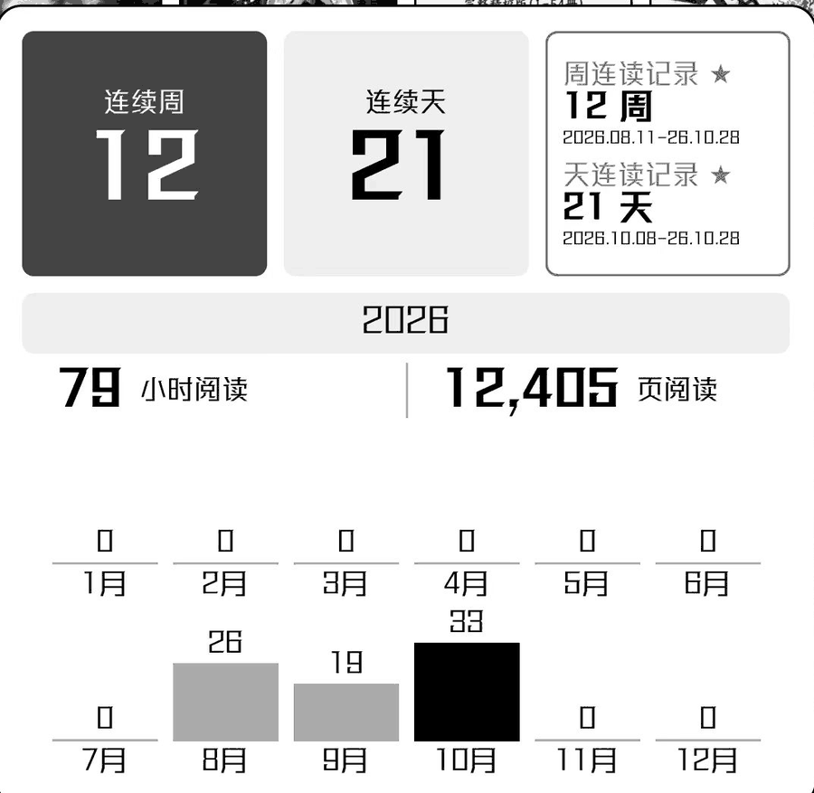
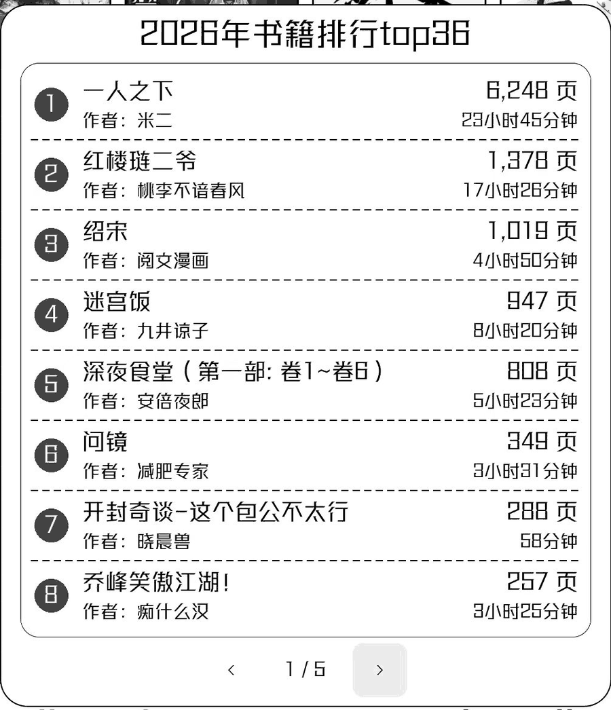
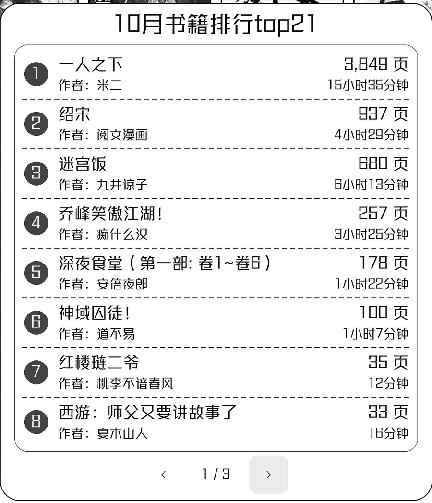

# 轻量版阅读统计 · 阅读足迹（readingstats.koplugin）

[](https://github.com/seaneasysaid/readingstats.koplugin/releases/latest)
[](https://github.com/seaneasysaid/readingstats.koplugin/releases/latest)
[](CHANGELOG.md)

> KOReader 插件 —— 把阅读记录变成一张看得见的图。
> 菜单进入，无需手势；阅读报告 + 日历热力图 + GitHub 风格全年贡献图 + 阅读分析，四视图并存。

**「轻量版」是什么意思**：相对 KOReader 内置的 **「阅读统计」** 插件，本插件只做
「看图」这一件事 —— 不接管阅读器统计逻辑、不改阅读界面、不加手势、不常驻后台。
它只是在菜单里多一个入口，点开就读 `statistics.sqlite3` 画图，关掉即退出。


- 项目名：**轻量版阅读统计 · 阅读足迹**
- 菜单里显示的名字：**阅读足迹**（在内置「阅读统计」下面）
- 目录 / 内部名：`readingstats.koplugin`

---

## 功能

| 视图 | 说明 |
| --- | --- |
| **阅读报告** | 全屏卡片视图（**仿微信读书风格**）：**周 / 月 / 年 / 总** 四周期切换，概览（时长 / 天数 / 日均 / 较上期）+ 阅读时长趋势柱图 + 读书排行 Top10 + 阅读偏好。底部 `上一周期 / 下一周期` 翻页。 |
| **日历阅读统计** | 月历形式，每格显示日期 + 当日时长（中文「x小时x分钟」，格窄时自动缩写），背景 4 级灰。标题两侧 `<` `>` 方框按钮翻月，底部图例 + **本月阅读天数**；下方一行是**四项时长**（今日 / 本周 / 本月 / 累计）。**点任意一天**，再下面的卡片就显示当天的书单：名次 · 书名·作者 · 时长，每行带一条按比例的长度条，书多可上下滑动。 |
| **阅读热力图** | 标准 GitHub 贡献图：周为列、周一~周日为行，5 级灰阶。标题两侧 `<` `>` 方框按钮整段翻页，可选 26 周（单行）或 52 周（两行）。 |
| **阅读分析** | 按年统计：连续周 / 连续天、年度汇总（小时阅读 / 天阅读可互切，右侧为页阅读）、12 个月柱状图，可下钻到**年度 / 月度书籍排行**。 |
| **设置** | 热力图跨度、阅读分析每页行数。 |

---

## 界面

### 菜单入口

顶部菜单 → ☰ 工具 → **阅读足迹**（就在内置「阅读统计」下面）。



层级：`☰ 工具` → `阅读足迹` → `阅读报告 / 日历阅读统计 / 阅读热力图 / 阅读分析 / 设置`

### ① 阅读报告（全屏 · 本月 · 仿微信读书）

> 卡片式布局、周期切换与各项统计的**视觉风格**参考微信读书（WeRead）的「阅读统计」；数据完全来自本地 `statistics.sqlite3`，代码独立实现（本项目为 MIT，故未使用 WeRead 插件的代码或云端数据）。

顶部标题居中（如 `本月·2026年09月`），下面一排 **周 / 月 / 年 / 总** 周期切换条；主体为四张卡片：**概览 / 阅读时长趋势 / 读书排行 / 阅读偏好**；底部为 `上一周期 / 下一周期`。



### ② 日历阅读统计

上方是月历（格子内为当天阅读时长，灰阶越深读得越久），底部一行图例 + 「本月阅读 N 天」；再往下是四项时长（今日 / 本周 / 本月 / 累计）。最后一张卡片是**当天阅读详情**：按阅读时长排出当天读过的书，每行「名次 · 书名 · 作者」+ 右侧时长，行下一条按比例的长度条。



### ③ 阅读热力图 · 26 周（单行铺满）



### ③ 阅读热力图 · 52 周（拆成两行，每行 26 周）



### ④ 阅读分析

顶部是连续阅读（连续周 / 连续天 / 周·天连读记录），中间是年份与年度汇总，下面是 12 个月柱状图。



### ④-1 年度书籍排行（点「页阅读」进入）



### ④-2 月度书籍排行（点某根月份柱进入）



---

## 哪里可以点，点了会怎样

### 菜单

| 位置 | 操作 | 结果 |
| --- | --- | --- |
| ☰ 工具 → **阅读足迹** | 点击 | 展开子菜单 |
| 阅读报告 | 点击 | 打开**全屏阅读报告**（默认本月） |
| 日历阅读统计 | 点击 | 打开月历弹窗 |
| 阅读热力图 | 点击 | 打开热力图窗口 |
| 阅读分析 | 点击 | 打开年度分析弹窗 |
| 设置 | 点击 | 展开设置子菜单 |
| 设置 → 热力图跨度 | 点击 | 在 **26 周** / **52 周** 之间切换 |
| 设置 → 阅读分析每页行数 | 点击 | 在 **7 行** / **8 行** 之间切换 |

### ① 阅读报告 —— 周期条 / 翻页 / 关闭

| 位置 | 操作 | 结果 |
| --- | --- | --- |
| 顶部 **周 / 月 / 年 / 总** | 点击 | 切换统计周期（本周 / 本月 / 本年 / 累计） |
| 右上角 **关闭** | 点击 | 退出阅读报告 |
| 底部 **上一周期 / 下一周期** | 点击 | 向前 / 向后翻一个周期（到顶 / 到底时置灰） |
| 卡片区 | 上下滑动 | 滚动查看四张卡片（概览 / 趋势 / 排行 / 偏好） |

### ② 日历阅读统计 —— 翻月 / 点选日期 / 滑动书单

| 位置 | 操作 | 结果 |
| --- | --- | --- |
| 标题两侧的 **< >** | 点击 | 上一个月 / 下一个月（翻月后默认选中 15 号） |
| 日期格子 | 点击 | 选中该天，下方「X月X日 阅读详情」立即跟着切换 |
| 阅读详情 · 书单 | 上下滑动 | 书多时滚动查看（**只滚动书单**，上方日历不动） |
| 左上角 **<< 返回** | 点击 | 关闭弹窗（实体返回键同样可用） |
| 其他任意位置 | 点击 / 滑动 | **不响应**，不会误退出弹窗 |

### ③ 阅读热力图 —— 只有翻页钮能点

| 位置 | 操作 | 结果 |
| --- | --- | --- |
| 标题两侧的 **< >** | 点击 | 整段向前 / 向后翻一屏（**不会翻到未来**） |
| 格子 | — | **不可点击**，只负责显示 |
| 其他任意位置 | 点击 / 滑动 / 按键 | 关闭弹窗 |

### ④ 阅读分析 —— 4 个热区

| 位置 | 操作 | 结果 |
| --- | --- | --- |
| 年份数字（如 `2026`） | 点击 | 弹出**年份列表**（跨越多个年份时才有），点哪年跳哪年 |
| 年份数字 | **长按** | 弹出**高级菜单**：检查新统计 / 强制重载连续天数 / 强制重载当年分析 |
| 年份两侧的 ‹ › 箭头 | 点击 | 上一年 / 下一年 |
| 右侧格 **页阅读** | 点击 | 打开 **当年书籍排行**（如「2026年书籍排行top36」） |
| 任意一根月份柱 | 点击 | 打开 **该月书籍排行**（如「10月书籍排行top21」） |
| 左侧格 **小时阅读 / 天阅读** | 点击 | 在「阅读小时」与「阅读天数」两种口径之间切换 |
| 屏幕空白处 | 左右滑动 | 等价于上一年 / 下一年 |
| 屏幕 | 其他方向滑动 / 点击空白 / 按键 | 关闭弹窗 |

> 注意：**月份标签本身不可点**，要点柱状图的柱子；柱子只有当月有数据才可点。

### ④-1 / ④-2 书籍排行弹窗

| 位置 | 操作 | 结果 |
| --- | --- | --- |
| 标题 | 点击 | 关闭本弹窗，**回到「阅读分析」** |
| **‹** | 点击 | 上一页 |
| **‹** | 长按 | 直接跳到**第一页** |
| **›** | 点击 | 下一页 |
| **›** | 长按 | 直接跳到**最后一页** |
| 书名列（书名 / 作者 / 页数 / 时长） | — | **不可点击**，只负责显示 |
| 其他位置 | 点击 / 按键 | 关闭弹窗 |

最后一页底部会多出一行汇总：**总页数 / 总时长**（一行放不下时自动折成两行）。

每行显示：排名圆标 · 书名 · 作者 · 累计页数 · 累计时长。

---

## 安装

**方式一：下载 Release 压缩包（推荐）**

1. 到 [Releases](https://github.com/seaneasysaid/readingstats.koplugin/releases/latest)
   下载 `readingstats.koplugin.zip`（或点上面的徽章）。
2. 解压得到 `readingstats.koplugin/` 目录（zip 里已带这层目录，直接解压即可）。
3. 把整个目录拷进设备的 KOReader 插件目录：

   | 设备 | 路径 |
   | --- | --- |
   | Kindle | `<USB 盘符>/koreader/plugins/` |
   | Kobo | `<USB 盘符>/.adds/koreader/plugins/` |
   | Android | `/sdcard/koreader/plugins/` |

4. **彻底重启 KOReader**（退出再进，不是回书架）。
5. 顶部菜单 → ☰ → **阅读足迹**。

**方式二：直接取源码**

1. 下载仓库里的 `readingstats.koplugin/` 整个目录（6 个 `.lua` 文件），后续步骤同上。

卸载：直接删掉 `readingstats.koplugin/` 目录并重启。

---

## 热力图实现说明

- **5 级灰阶**：`168 / 122 / 76 / 25`，在墨水屏上实测过对比度，层次拉得开。
- **p90 分位归一化**：取有阅读天数时长的 90 分位作为上限（下限 60 秒），
  再按 25 / 50 / 75 / 100% 四分位分级。避免某天读爆把整张图拉平。
- **周一对齐**：网格起始日对齐到周一，第 `i` 天即第 `i % 7` 行。
- **未来日期留白**：今天之后的格子不画边框，不与「没读」混淆。
- **52 周自动分两行**：每行 26 周，格子尺寸与 26 周模式一致，横向铺满窗口。
  跨行处月份标签去重，不会重复出现同一个月。
- 热力图以**屏幕控件**绘制（非静态图片），因此可交互、可翻页。

---

## 兼容性

- KOReader 2024.x ~ 2026.x
- 已在 Kindle（改装版）、Kobo、Android（MuMu 模拟器）上实测
- 若设备装了 SimpleUI 等定制底栏，点底栏「设置」可能唤不出菜单，
  请改用**菜单键**或**顶部下滑手势**

---

## 目录结构

```
readingstats.koplugin/
├── main.lua                # 插件入口：菜单注入、设置
├── _meta.lua               # 插件元信息
├── reading_stats_view.lua  # ① 阅读报告（全屏卡片）
├── calendar_stats.lua      # ② 日历阅读统计
├── heatmap_view.lua        # ③ 阅读热力图
└── reading_insights.lua    # ④ 阅读分析 + 书籍排行
```

---

## 许可

MIT

---

## 项目推荐

| 插件 | 简介 |
| --- | --- |
| [legadocomic.koplugin](https://github.com/seaneasysaid/legadocomic.koplugin) | KOReader 上直接看漫画 —— 对接「开源阅读」(Legado) 的 Web 服务在线流式加载，不必先下载整本。 |
| [leko-reader-fixed](https://github.com/seaneasysaid/leko-reader-fixed) | 全程本地运行的网络小说插件 —— 支持 Legado 兼容书源，在线阅读轻快流畅。（非官方增强版 Fork，基于上游 0.16.0 的本地定制。） |
| [fanqie.koplugin-fixed](https://github.com/seaneasysaid/fanqie.koplugin-fixed) | 番茄小说非官方增强版 —— 适配书山聚合 + 知秋段评，正文无广告，节点测速自动切换。（非官方增强版 Fork，基于上游v2.2.0 的本地定制。） |
| [koreader-remote](https://github.com/seaneasysaid/koreader-remote) | 手机 / 电脑浏览器无线遥控 KOReader —— 局域网内翻页、搜索、传书，全程不必碰设备。 |
